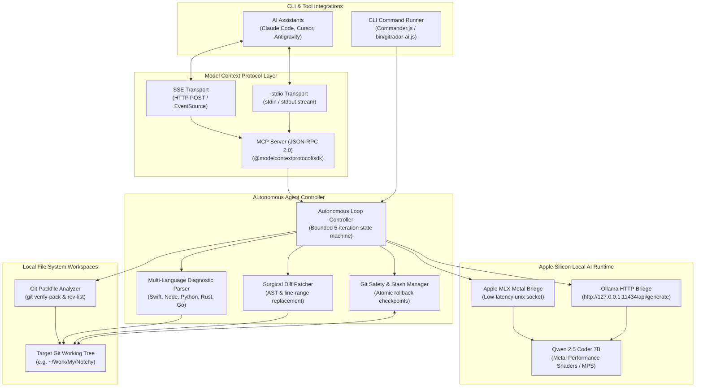
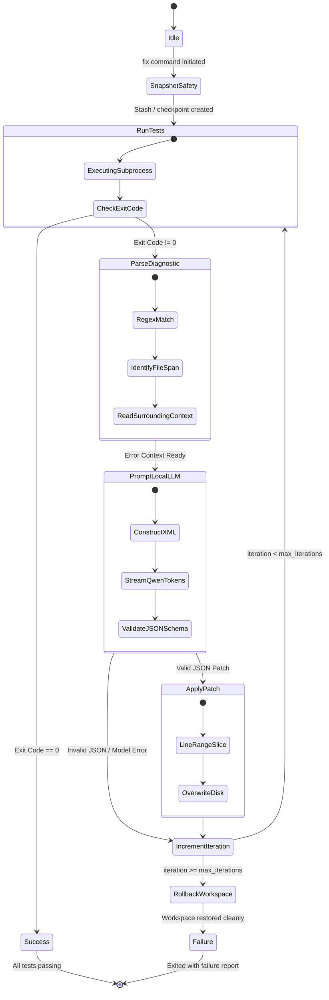

# ARCHITECTURE.md — GitRadar AI System Architecture

> Structural architecture, state machines, process communication, and data flow pipelines for GitRadar AI.

---

## 🏗️ 1. Complete System Architecture



---

## 🔄 2. Autonomous Loop State Machine

The loop controller implements a finite state machine with strict termination bounds:



---

## 🛡️ 3. Atomic Stash & Rollback Protocol

To guarantee that autonomous repairs never leave user code in a corrupted state:

1. **Pre-flight Snapshot**:
   ```bash
   # Capture current SHA and unstaged diff
   git rev-parse HEAD > .gitradar_base_sha
   git diff > .gitradar_safety_diff
   # Create detached stash without altering working tree
   STASH_ID=$(git stash create "gitradar-ai pre-fix backup")
   ```
2. **Iteration Checkpoint**:
   - Each automated edit records the target file and original lines in `.gitradar_history.json`.
3. **Rollback Execution**:
   - If tests fail to converge within `max_iterations`, the engine restores the original state:
   ```bash
   git checkout -- .
   git clean -fd
   if [ -n "$STASH_ID" ]; then
       git stash apply "$STASH_ID"
   fi
   ```

---

## 🔌 4. Local Model Connector (Ollama & MLX)

GitRadar AI interfaces directly with local models via streaming JSON:

```typescript
export interface LocalModelRequest {
  model: string;          // e.g. "qwen2.5-coder:7b"
  prompt: string;
  systemPrompt: string;
  temperature: number;    // default: 0.1 for deterministic repairs
  maxTokens: number;      // default: 2048
}

export async function promptQwen(request: LocalModelRequest): Promise<string> {
  const response = await fetch("http://127.0.0.1:11434/api/generate", {
    method: "POST",
    headers: { "Content-Type": "application/json" },
    body: JSON.stringify({
      model: request.model,
      prompt: request.prompt,
      system: request.systemPrompt,
      stream: false,
      options: {
        temperature: request.temperature,
        num_predict: request.maxTokens,
        num_thread: 8 // Utilize 8 performance cores on M2 Pro
      }
    })
  });
  
  const data = await response.json();
  return data.response;
}
```
